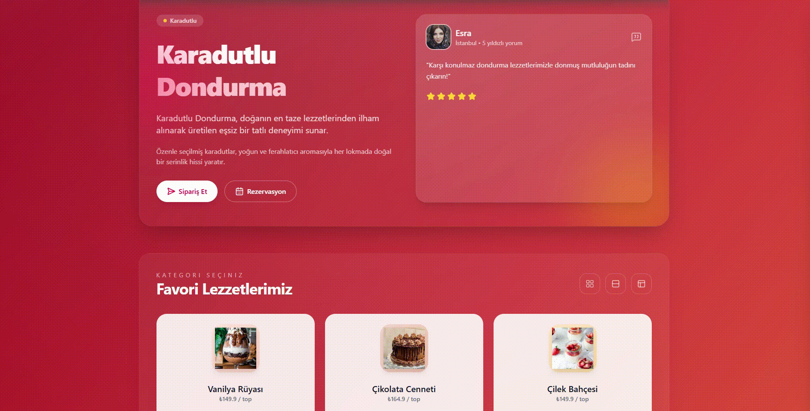

# 🍦 Ice Cream App

A beautiful and intuitive web application for ordering ice cream, built with React, TailwindCSS, and modern web technologies.

## ScreenShot



## 📋 Features

- Browse a catalog of delicious ice cream flavors
- Add ice cream to your basket with customization options (cup or cornet)
- Manage your basket (adjust quantities, remove items)
- Complete mock orders with notifications
- Responsive design for mobile and desktop
- Modern UI with Tailwind CSS

## 🚀 Technologies Used

- **React 19** - UI library
- **Vite 7** - Next-generation build tool and dev server
- **TailwindCSS v4.0** - Modern utility-first CSS framework (latest version)
- **Axios** - HTTP client for API calls
- **React-Toastify** - Toast notifications
- **Lucide-React** - Beautiful icon library
- **JSON-Server** - Mock REST API

## 📦 Installation

1. Clone the repository
2. Install dependencies:

```bash
npm install
```

## 🏃‍♂️ Running the Application

### Step 1: Start the JSON Server (Mock Backend)

In one terminal, run:

```bash
npm run server
```

This will start the JSON server on `http://localhost:3000`

### Step 2: Start the Development Server

In another terminal, run:

```bash
npm run dev
```

This will start the Vite development server (usually on `http://localhost:5173`)

### Both Terminals Running

Make sure both terminals are running simultaneously:
- Terminal 1: JSON Server (port 3000)
- Terminal 2: Vite Dev Server (port 5173)

## 📁 Project Structure

```
4-ice-cream/
├── src/
│   ├── assets/         # Images and static assets
│   │   └── images/
│   ├── components/     # Reusable UI components
│   ├── context/        # React Context API for state management
│   ├── features/       # Feature-based components
│   ├── services/       # API services and Axios configuration
│   │   ├── api.js              # Axios instance with interceptors
│   │   └── ice-cream-service.js # Ice cream API endpoints
│   ├── App.jsx         # Main application component
│   ├── main.jsx        # Application entry point
│   └── index.css       # Global styles with Tailwind
├── db.json             # JSON Server database
├── vite.config.js      # Vite configuration with Tailwind v4 plugin
└── package.json        # Dependencies and scripts
```

## 🛠️ Available Scripts

- `npm run dev` - Start Vite development server
- `npm run build` - Build for production
- `npm run preview` - Preview production build
- `npm run lint` - Run ESLint
- `npm run server` - Start JSON Server mock API

## 🎨 Design Principles

- **Component-based architecture** - Modular and reusable components
- **Context API** - For global state management
- **Service layer** - Centralized API calls
- **Responsive design** - Mobile-first approach with Tailwind
- **Accessibility** - WCAG 2.1 guidelines

## 📝 API Endpoints

The JSON Server provides the following endpoints:

- `GET /icecreams` - Get all ice creams
- `GET /icecreams/:id` - Get a specific ice cream

## 🔧 Configuration

### Tailwind CSS v4.0

This project uses the **latest Tailwind CSS v4.0** with modern CSS-based configuration:
- Custom colors defined using CSS variables in `@theme` block
- No `tailwind.config.js` needed - all config in CSS
- Direct Vite integration with `@tailwindcss/vite` plugin
- Beautiful gradient background and custom button styles

See `TAILWIND-V4-SETUP.md` for detailed information about the v4 setup.

### Axios

The Axios instance is configured in `src/services/api.js` with:
- Base URL: `http://localhost:3000`
- Request/Response interceptors
- Global error handling with toast notifications

## 📖 Development Guidelines

- Use functional components with React Hooks
- Follow naming conventions (PascalCase for components, camelCase for functions)
- Event handlers should start with `handle` prefix
- Use TailwindCSS for all styling
- Keep components under 500 lines of code
- Write clean, maintainable, and well-documented code

## 🎯 Next Steps

Refer to the `PRD.md` file for detailed requirements and implementation phases.

## 📄 License

This project is for educational purposes.

---

**Enjoy building and customizing your Ice Cream App! 🍦✨**
